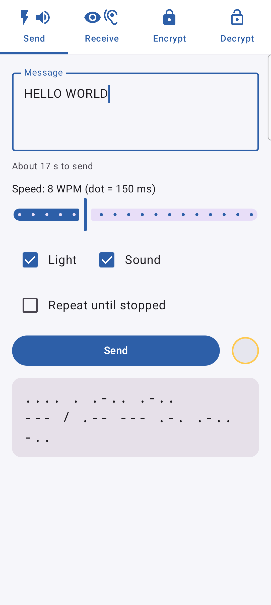
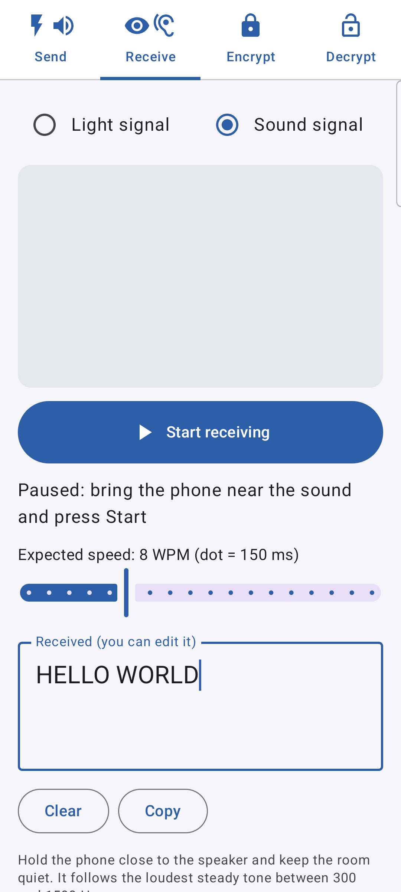
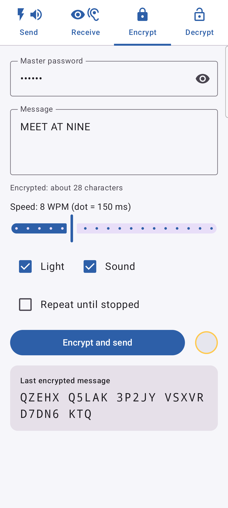
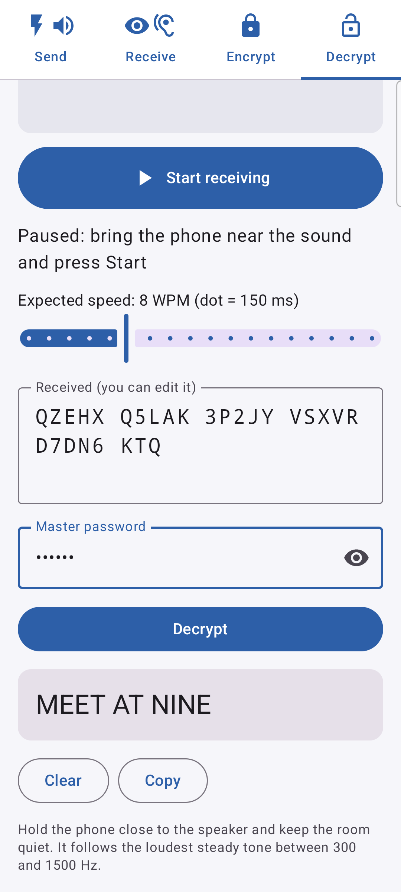

# MorseLightCrypt

<p align="center"><a href="README.md">English</a> · Español</p>

<p align="center">
  
</p>
<p align="center">
  
  
  
  
</p>

App de Android que envía texto en **código Morse con la linterna o con pitidos** y lo vuelve a
leer **con la cámara o el micrófono**, si quieres **cifrado** con una contraseña maestra.

Un móvil parpadea o pita; otro mira la luz o escucha y convierte los pulsos otra vez en texto.
También funciona con cualquier otra luz que parpadee (una lámpara, una pantalla, una linterna a
lo lejos) y con cualquier tono Morse (una radio, un ordenador, otro móvil, un instrumento).

Sin permiso de red: del móvil solo salen luz y sonido. El micrófono solo está abierto mientras
recibes por sonido; no se graba ni se guarda nada.

En inglés, castellano, portugués, francés, alemán, italiano, neerlandés, polaco, ruso, ucraniano,
chino, japonés, coreano, tailandés e hindi.

## Instalar

- **[F-Droid](https://f-droid.org/packages/com.javimetallab.morselightcrypt/)**: busca
  *MorseLightCrypt* en la app de F-Droid (o en Droid-ify, Neo Store…); ella la mantiene al día.
- **APK** de la [última versión](https://github.com/javimentallab/MorseLightCrypt/releases/latest).
  F-Droid la compila de forma reproducible y distribuye este mismo APK firmado, así que puedes
  cambiar de una fuente a otra y seguir actualizando.

---

## Pestañas

**Enviar** → escribe un mensaje, elige la velocidad, marca *Luz*, *Sonido* o los dos y pulsa
*Emitir*. La pantalla enseña qué letra está saliendo. *Repetir hasta detener* lo envía en bucle,
con una pausa más larga entre vueltas, para que quien recibe tenga tiempo de colocarse.

**Recibir** → elige *Señal de luz* o *Señal sonora*. Por luz, apunta el cuadrado a la luz; por
sonido, acerca el móvil a los pitidos. Luego pulsa *Empezar a recibir*. El texto aparece según
llega, cada vuelta de un mensaje en bucle en su propia línea. Pulsa *Parar* al terminar: entonces
puedes corregir a mano el texto recibido, para borrar letras sueltas o arreglar una mal leída.

**Cifrar** → igual que Enviar, pero el mensaje se cifra antes con una contraseña maestra y lo que
sale por luz o sonido es el texto cifrado: letras y números en grupos de cinco.

**Descifrar** → recibe, escribe la contraseña maestra y pulsa *Descifrar*. Cada línea recibida se
descifra por separado y se muestra en orden; si una línea no se abre, lo dice. No se mezcla ni se
descarta nada.

> ⚠️ La contraseña maestra no se puede recuperar. Si la olvidas, no podrás abrir ningún mensaje.

## Para recibir bien

- **Apunta el cuadrado a la luz** y pellizca para hacer zoom si está lejos. El cuadrado solo sigue
  lo que *parpadea*: una pantalla o una ventana brillante junto a la lámpara no molesta.
- **Sujétalo quieto o apoya el móvil.** Tolera el pulso de la mano (aviso ámbar); si mueves el móvil,
  la lectura se pausa (aviso rojo) y sigue cuando la imagen está quieta. Lo ya leído se conserva.
- **La velocidad se mide sola.** El control *Velocidad esperada* solo es la primera estimación
  hasta que se han visto puntos y rayas.
- **Usa Repetir al enviar** y compara las líneas: una sacudida durante una vuelta solo estropea esa
  línea.

Probado con la linterna del móvil y con una bombilla inteligente del 100 % al 2 % de brillo, de
cerca y de una punta a otra de una habitación con zoom de 10×, con el móvil en la mano.

Por sonido:

- **Acerca el móvil al altavoz** y procura que haya silencio. Voces, toses y golpes se ignoran casi
  siempre, pero una palabra dicha encima de un pitido puede estropear una letra; *Repetir* también
  ayuda aquí.
- **Vale cualquier tono entre 300 y 1500 Hz**: la app encuentra sola el de quien envía. Ella envía a
  700 Hz, un tono habitual en Morse.

Probado en los dos sentidos entre un móvil y los altavoces y el micrófono de un ordenador, sin
cifrar y cifrado, en una habitación normal con su eco.

## Cómo funciona

La cámara va a 30 fps fijos con la exposición oscura y bloqueada, para que la exposición automática
no deshaga el contraste cuando se enciende una luz. En cada imagen, el cuadrado central se divide en
bloques de 8×8; la app recuerda el valor más oscuro y el más brillante de cada bloque en los últimos
instantes y mide solo los bloques que más oscilan. Una luz que parpadea oscila; una pantalla brillante
y constante, no.

Si unos bloques se aclaran *y* otros se oscurecen en la misma imagen, lo que se ha movido es el móvil,
no la luz: la lectura se pausa y vuelve a empezar cuando está quieto, conservando el texto ya leído.

Por sonido, el micrófono (sin procesar cuando el móvil lo permite, así no hay ganancia automática)
se mide cada 10 ms en ventanas de 20 ms con un banco de filtros de Goertzel de 300 a 1500 Hz. La app
sigue el tono cuyos picos recientes destacan bien sobre el resto del espectro, y solo cuenta un pitido
mientras ese tono es un pico estrecho claramente por encima del ruido: un chasquido o una tos son
anchos. Un pitido está «encendido» mientras se mantiene a pocos decibelios de su propio volumen, no a
medio camino entre el silencio y el volumen, porque el eco de una habitación lo mantiene sonando muy
por encima del silencio después de terminar y se comería los huecos entre puntos.

Las duraciones de encendido y apagado van al decodificador, que vuelve a decodificar toda la grabación
cada vez:

- los puntos y las rayas se distinguen por agrupamiento, y la longitud de la unidad sale de
  `raya − punto = 2 unidades`, lo que además cancela el retardo de encendido de una lámpara (las
  bombillas inteligentes se encienden poco a poco);
- las series de destellos mucho más cortos que el resto son parpadeo; un solo «destello» muchas veces
  más largo que el normal es un cambio en la escena, no Morse;
- los huecos de 1, 3, 7 y 14 unidades separan elementos, letras, palabras y vueltas.

## Cifrado

Cada carácter enviado por luz o sonido cuesta segundos, así que el formato es lo más corto posible sin
dejar de ser sólido para uso personal:

```
salt (4 bytes) ‖ texto cifrado AES-256-CTR ‖ etiqueta HMAC-SHA256 cortada a 4 bytes
```

- Claves: PBKDF2-HMAC-SHA256, 600 000 rondas, sobre la contraseña maestra (NFC, UTF-8) y
  `"morselightcrypt/v1" ‖ salt`; 64 bytes repartidos entre las claves de AES y de HMAC. Un salt
  aleatorio nuevo da claves nuevas en cada mensaje, y por eso el contador puede empezar en cero.
- El texto se empaqueta a 6 bits por carácter (Morse no tiene minúsculas) y luego todo se escribe en
  base 32 (`A–Z 2–7`) en grupos de cinco.
- El coste fijo son 13 caracteres: «HOLA MUNDO» ocupa 26.
- La etiqueta de 32 bits detecta una letra mal leída o una contraseña equivocada; falsificar un
  mensaje supone acertar una entre cuatro mil millones, con cada intento emitido a mano.

PBKDF2 está implementado en la app (`Pbkdf2.kt`, comprobado contra el JDK y la RFC 7914): el del propio
Android tarda varios segundos con 600 000 rondas, este unos 0,75 s.

## Herramientas

En [`tools/`](tools), para probar el receptor sin un segundo móvil:

- `hue_morse.py` emite un mensaje con una bombilla Philips Hue, directamente por la API local del
  puente (`--brightness`, `--repeat`, `--wpm`). Solo usa la biblioteca estándar.
- `blink.html` emite un mensaje con toda la pantalla de un ordenador, con tiempos exactos.
- `secret_codec.py` cifra y descifra en el formato de la app (necesita `cryptography`), para que un
  ordenador también pueda enviar o leer mensajes cifrados.

## Compilar

JDK 17 o 21, Android SDK 36:

```
./gradlew testDebugUnitTest assembleDebug
```

Las versiones de release se firman si un fichero `keystore.properties` (que no está en el repositorio)
apunta a la clave.

## Licencia

[MIT](LICENSE). Las licencias de terceros están en [NOTICE](NOTICE).
