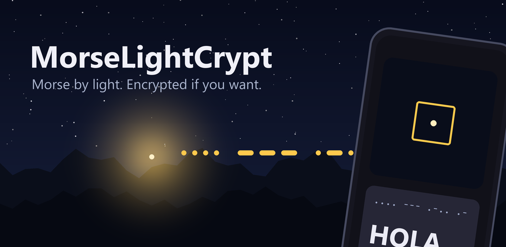
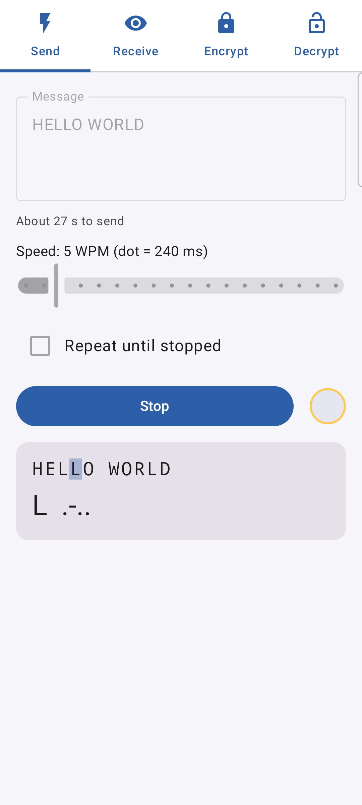
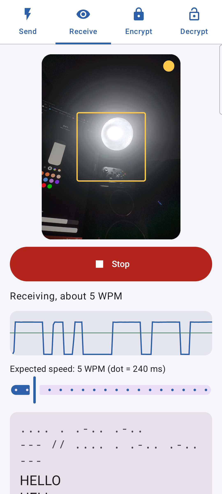
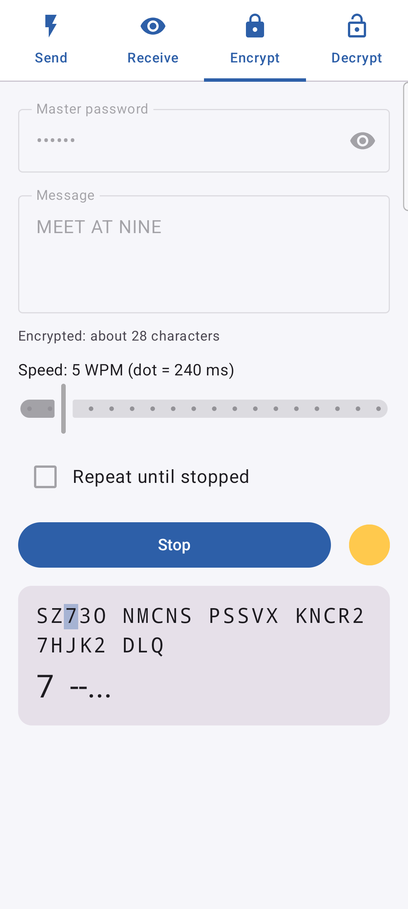
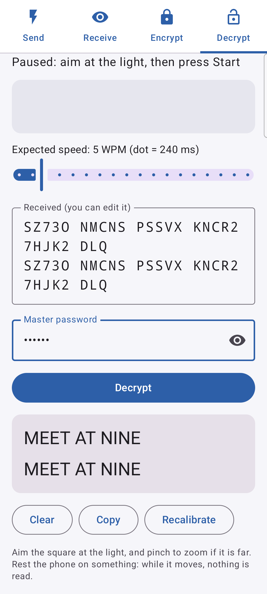

# MorseLightCrypt

<p align="center">
  
</p>
<p align="center">
  
  
  
  
</p>

Android app that sends text as **Morse code with the flashlight or as beeps** and reads it back
**with the camera or the microphone**, optionally **encrypted** with a master password.

One phone flashes or beeps, another one watches the light or listens and turns the pulses back
into text. It also works with any other blinking light (a lamp, a screen, a torch in the
distance) and any Morse tone (a radio, a computer, another phone, an instrument).

No network permission: nothing leaves the phone except light and sound. The microphone is open
only while receiving by sound; nothing is recorded or stored.

In English, Spanish, Portuguese, French, German, Italian, Dutch, Polish, Russian, Ukrainian,
Chinese, Japanese, Korean, Thai and Hindi.

## Install

- **[F-Droid](https://f-droid.org/packages/com.javimetallab.morselightcrypt/)** — search for *MorseLightCrypt* in
  the F-Droid app (or Droid-ify, Neo Store…); it keeps the app updated.
- **APK** from the [latest release](https://github.com/javimentallab/MorseLightCrypt/releases/latest).
  F-Droid builds it reproducibly and ships this same signed APK, so you can switch
  between both sources and keep updating.

---

## Tabs

**Send** → type a message, pick the speed, tick *Light*, *Sound* or both, *Send*. The screen
shows which letter is going out. *Repeat until stopped* sends it in a loop, with a longer pause
between repeats, so the receiver has time to get settled.

**Receive** → choose *Light signal* or *Sound signal*. By light, aim the square at the light; by
sound, bring the phone near the beeps. Then press *Start receiving*. The text appears as it
comes in, each repeat of a looped message on its own line. *Stop* when done: the received text
can then be edited by hand, to delete stray letters or fix a misread one.

**Encrypt** → the same as Send, but the message is first encrypted with a master password and
what goes out by light or sound is the ciphertext: letters and digits in groups of five.

**Decrypt** → receive, type the master password, *Decrypt*. Every received line is decrypted on
its own and shown in order; a line that does not open says so. Nothing is merged or dropped.

> ⚠️ The master password has no recovery. Forget it and no message can be opened.

## Receiving well

- **Aim the square at the light** and pinch to zoom if it is far. The square only follows what
  *blinks*: a bright screen or window next to the lamp does not get in the way.
- **Hold still, or rest the phone.** A shaky hand is tolerated (amber warning); moving the phone
  pauses reading (red warning) and it resumes once the picture is still. What was read is kept.
- **The speed is measured automatically.** The *Expected speed* slider is only the first guess
  until dots and dashes have been seen.
- **Use Repeat when sending** and compare the lines: a jolt during one repeat only spoils that
  line.

Tested with the phone's flashlight and with a smart bulb from 100 % down to 2 % brightness,
close up and across a room at 10× zoom, held by hand.

By sound:

- **Bring the phone near the speaker** and keep the room quiet. Voices, coughs and knocks are
  mostly ignored, but a word spoken over a beep can spoil a letter; *Repeat* helps here too.
- **Any pitch between 300 and 1500 Hz** works: the app finds the sender's tone by itself. It
  sends at 700 Hz, a usual sidetone.

Tested both ways between a phone and a computer's speakers and microphone, plain and
encrypted, in an ordinary room with its echo.

## How it works

The camera runs at a fixed 30 fps with the exposure set dark and locked, so a light switching on
does not make the auto exposure undo the contrast. Each frame, the centre square is cut into 8×8
blocks; the app remembers each block's darkest and brightest recent value and measures only the
blocks that swing the most. A blinking light swings, a steady bright screen does not.

Blocks that brighten *and* darken in the same frame mean the phone moved, not the light: reading
pauses and starts over once it is still, keeping the text read so far.

By sound, the microphone (unprocessed where the phone offers it, so no automatic gain) is
measured every 10 ms over 20 ms windows by a bank of Goertzel filters from 300 to 1500 Hz. The
app follows the pitch whose recent peaks stand well above the rest of the spectrum, and counts a
beep only while that pitch is a narrow peak clearly above the noise: a click or a cough is wide.
A beep is "on" while it stays within a few decibels of its own loudness, not halfway between
silence and loudness, because a room's echo keeps it ringing well above the silence after it
stopped and would otherwise swallow the gaps between dots.

On/off durations go to the decoder, which re-decodes the whole recording each time:

- dots and dashes are told apart by clustering, and the unit length comes from `dash − dot = 2
  units`, which also cancels a lamp's switch-on delay (smart bulbs fade in);
- runs of flashes far shorter than the rest are flicker; a single "flash" many times longer
  than the typical one is a change in the scene, not Morse;
- gaps of 1, 3, 7 and 14 units separate elements, letters, words and repeats.

## Encryption

Every character sent by light or sound costs seconds, so the format is as short as it can be while
staying sound for personal use:

```
salt (4 bytes) ‖ AES-256-CTR ciphertext ‖ HMAC-SHA256 tag cut to 4 bytes
```

- Keys: PBKDF2-HMAC-SHA256, 600 000 rounds, over the master password (NFC, UTF-8) and
  `"morselightcrypt/v1" ‖ salt`; 64 bytes split into the AES and HMAC keys. A fresh random salt
  gives fresh keys for every message, which is what lets the counter start at zero.
- The plaintext is packed at 6 bits per character (Morse has no lowercase), then everything is
  written in base 32 (`A–Z 2–7`) in groups of five.
- The fixed cost is 13 characters: "HOLA MUNDO" becomes 26.
- The 32-bit tag catches a misread letter or a wrong password; forging a message means getting
  a guess past one in four billion, each attempt flashed by hand.

PBKDF2 is implemented in the app (`Pbkdf2.kt`, checked against the JDK and RFC 7914): Android's
own takes several seconds for 600 000 rounds, this one about 0.75 s.

## Tools

In [`tools/`](tools), for testing the receiver without a second phone:

- `hue_morse.py` flashes a message with a Philips Hue bulb, straight through the bridge's local
  API (`--brightness`, `--repeat`, `--wpm`). Standard library only.
- `blink.html` flashes a message with a whole computer screen, with exact timing.
- `secret_codec.py` encrypts and decrypts in the app's format (needs `cryptography`), so a
  computer can send or read encrypted messages too.

## Building

JDK 17 or 21, Android SDK 35:

```
./gradlew testDebugUnitTest assembleDebug
```

Release builds are signed when a `keystore.properties` file (not in the repository) points at
the key.

## License

[MIT](LICENSE)
